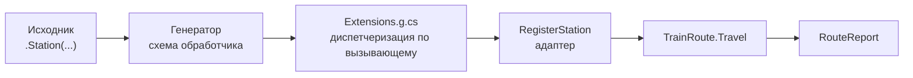
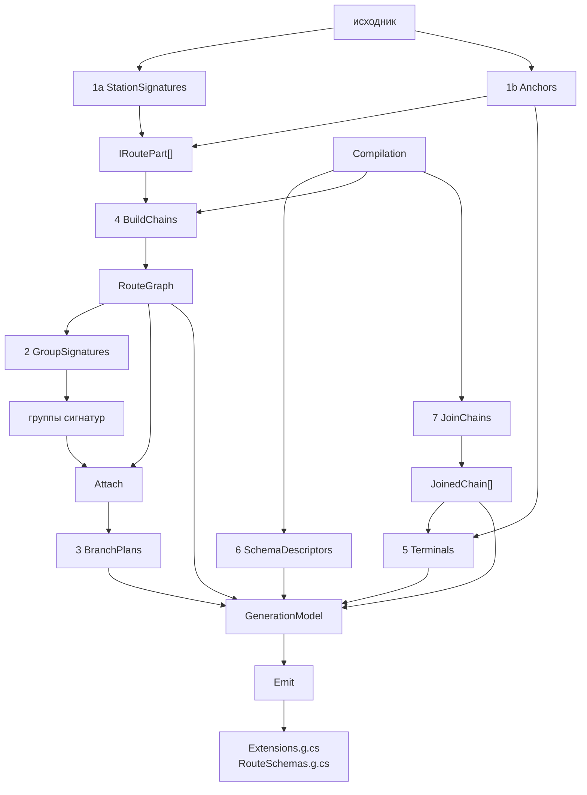
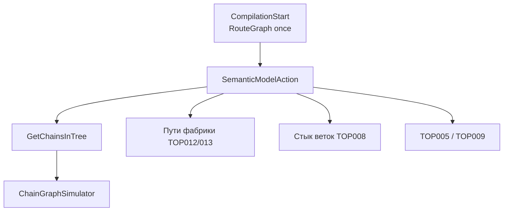
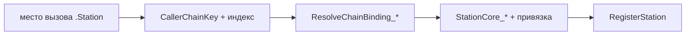
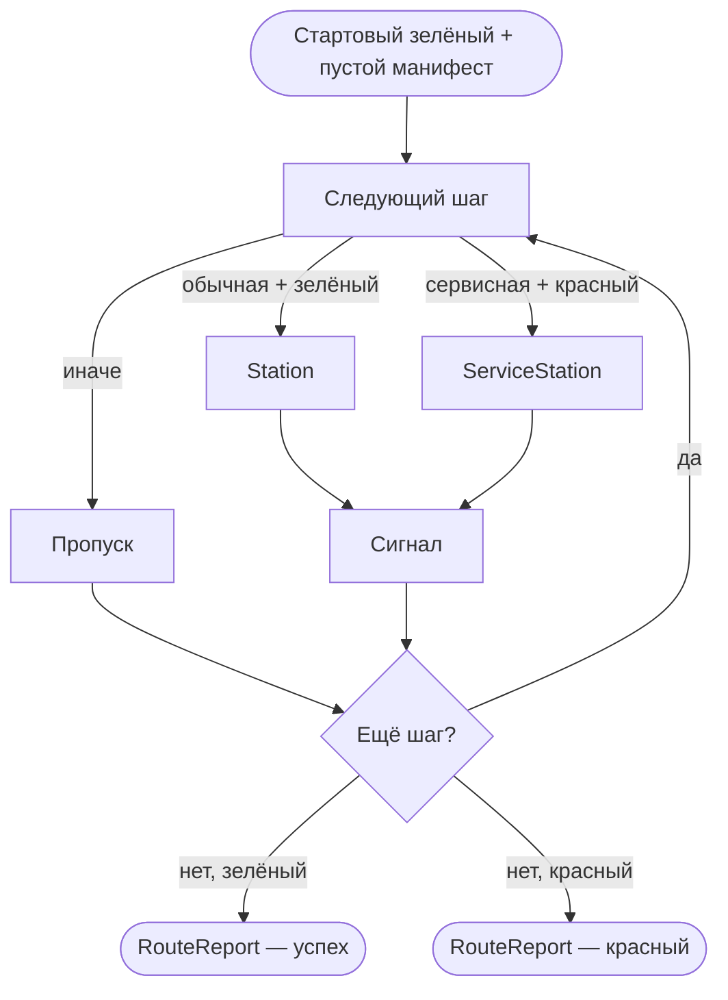

# TrainOP: учебник

Этот текст можно читать сверху вниз. Он — **исчерпывающее** руководство: зачем нужна библиотека, как писать маршруты, как текут данные и сигналы, как устроены генератор, анализатор и исполнение, маршруты между сборками, диагностики, ограничения и карта репозитория. Правила «как можно и нельзя собирать маршрут» собраны в **§10** (с сводкой в **§20**). Соседние файлы в `docs/` остаются краткими выдержками и дорожными картами для агентов; для понимания продукта достаточно учебника.

---

## 1. Зачем TrainOP

В обычном C#-коде конвейер «проверь → посчитай → сохрани» быстро обрастает вложенными `if`, ранними `return` и ручной передачей промежуточных значений. Железнодорожная модель предлагает другой ход: шаги идут по рельсам; успех везёт данные дальше; ошибка останавливает поезд на станции и не заставляет каждую следующую функцию проверять «а не сломалось ли уже».

TrainOP воплощает эту идею для .NET (`netstandard2.0`). Вы описываете **маршрут** из **станций**. Между станциями едет **манифест груза** — набор именованных значений («вагонов»). Станция либо обновляет груз и даёт **зелёный** сигнал, либо возвращает **красный** и останавливает движение. В конце вы получаете **отчёт**: доехали ли до конца, какие станции посетили, какой груз остался на терминале.

Главное удобство библиотеки — не в том, что вы руками крутите словарь. Рекомендуемый стиль — **обработчики над данными**: обычные функции. Имена параметров — это ключи вагонов. Возврат — новые данные или сигналы из `RailwaySignals`. Манифест и адаптеры вызова скрыты в коде, который пишет генератор исходного кода: он сам достаёт вагоны, вызывает обработчик и записывает возвращённые поля обратно в манифест.

Без генератора цепочка `.Station(...)` над данными не заработает: именно он порождает типизированные расширения. Анализатор в том же пакете ловит ошибки потока вагонов ещё на этапе компиляции.

На одном и том же сценарии оформления заказа (валидация, асинхронные шаги, отказы, восстановление, `CancellationToken`) TrainOP снимает ручной `StepResult`, вложенные `if (!ok)`, повторяемые проверки токена и часть `try/catch` — см. главу про объём кода. Цена — инфраструктура шага (манифест, адаптер, слияние, отчёт); по наносекундам библиотека не гонится за рукописным конвейером.

---

## 2. Метафора: рельсы, станции, сигналы

Думайте о пайплайне как о железной дороге.

**Манифест** (`CargoManifest`) — состав поезда: словарь `имя вагона → значение`. Он мутабельный: станции меняют его на месте через адаптер, а не передают новую копию на каждом шаге в пользовательском коде.

**Маршрут** (`TrainRoute`) — план пути: упорядоченный список станций, который вы собираете цепочкой вызовов.

**Запуск** — `TrainRoute.Travel()` / `TravelAsync()` / `TravelLight*`: рейс читает текущий план и получает свой пустой манифест. Шаг, добавленный после рейса, входит в следующий.

**Зелёный сигнал** — «продолжай». Груз обновлён (или оставлен как был) и едет дальше.

**Красный сигнал** — «стоп». Обычные станции дальше по плану на красном не вызываются; сработать может только следующая станция техобслуживания (если она есть).

**Отчёт** (`RouteReport`) — итог рейса: `ReachedDestination`, история визитов, `FailureCode` / `FailureMessage`, доступ к терминальным вагонам через `Get<T>` или индексатор.

Эти слова — не украшение API. Они помогают читать код: ранняя станция загружает состав, проверка ставит семафор, техобслуживание чинит состав или фиксирует ошибку.

---

## 3. Подключение

Один пакет **TrainOP**: исполнение, генератор исходного кода и анализатор цепочки.

| Содержимое пакета | Назначение |
|-------|------------|
| Исполнение (`lib/`) | `TrainRoute`, `CargoManifest`, сигналы, `Travel` |
| Анализатор (`analyzers/dotnet/cs/`) | Генератор исходного кода и анализатор цепочки для `.Station(...)` |

### Требования

- Пакет TrainOP: один целевой фреймворк **`netstandard2.0`** (потребитель — любая совместимая платформа, например `net8.0`).
- Проект **в стиле SDK** с поддержкой анализаторов и генераторов исходного кода (не `packages.config` без анализаторов).
- Дополнительных свойств MSBuild для диспетчеризации цепочки не нужно: режим один — **диспетчеризация по вызывающему** (конструктор и порядковый номер).

### NuGet (внешний проект)

```bash
dotnet add package TrainOP
# или явно:
dotnet add package TrainOP --version 0.19.0
```

```xml
<ItemGroup>
  <PackageReference Include="TrainOP" Version="0.19.0" />
</ItemGroup>
```

Для NuGet атрибуты `OutputItemType` / `ReferenceOutputAssembly` **не нужны**: генератор подключается из `analyzers/dotnet/cs` внутри пакета. Актуальную версию сверяйте с `CHANGELOG.md` / nuget.org.

В Visual Studio: **Tools → NuGet Package Manager → Manage NuGet Packages for Solution** — установите **TrainOP**.

### Локальный источник пакетов (упаковка из исходников)

```bash
dotnet pack src/TrainOP/TrainOP.csproj -c Release
```

Артефакт: `src/TrainOP/bin/Release/TrainOP.*.nupkg`.

```bash
# одноразовый источник
dotnet add package TrainOP --source C:\path\to\TrainOP\src\TrainOP\bin\Release

# или постоянный источник
dotnet nuget add source C:\path\to\local-nuget-feed --name trainop-local
```

### Проекты решения

Пакет один. Исходники генератора лежат в `src/TrainOP.Generators` и при упаковке попадают в `analyzers/dotnet/cs` того же `.nupkg`.

Проекты внутри решения, которые компилируют маршруты, ссылаются на `TrainOP.csproj` и на проект генератора как на анализатор: ссылка на исполнение сама анализатор не подключает, это делает NuGet у внешнего потребителя.

```xml
<ItemGroup>
  <ProjectReference Include="path/to/TrainOP/TrainOP.csproj" />
  <ProjectReference Include="path/to/TrainOP/TrainOP.Generators/TrainOP.Generators.csproj"
                    OutputItemType="Analyzer"
                    ReferenceOutputAssembly="false" />
</ItemGroup>

<Import Project="path/to/TrainOP/TrainOP.Generators/build/TrainOP.Generators.targets" />
```

Файл `.targets` зарезервирован и сейчас пуст. `Import` в проектах решения его подключает, свойств диспетчеризации цепочки он не задаёт: режим один, диспетчеризация по вызывающему.

### Проверка подключения

После `dotnet restore` / сборки:

1. В зависимостях виден пакет **TrainOP**. Внутри решения это ссылка на `TrainOP.csproj` и ссылка на проект генератора как на анализатор.
2. `.Station(...)` компилируется без «метод не найден».
3. Терминальные вагоны читаются через `report.Get<T>("name")` / `report["name"]`.

Если генератор «молчит»: убедитесь, что установлен **TrainOP** и выполнен restore; пересоберите проект; при кэше IDE — перезапуск; проверьте SDK-style. Ошибки `TOPxxxx` — контракт цепочки (см. главу про диагностики), а не «сломанный NuGet».

---

## 4. Первый маршрут

Начнём с короткого платёжного сценария: положить данные, снизить сумму, проверить, прочитать результат.

```csharp
using TrainOP;

var route = new TrainRoute()
    .Station("Seed", () => new { paymentId = "pay-1", amount = 100m })
    .Station("Discount", (string paymentId, decimal amount) =>
        new { paymentId, amount = amount * 0.9m })
    .Station("Validate", (string paymentId, decimal amount) =>
        amount > 0
            ? RailwaySignals.Green(new { paymentId, amount })
            : RailwaySignals.Red("INVALID_TOTAL", "amount must be positive"));

var report = route.Travel();

if (report.ReachedDestination)
{
    var paymentId = report.Get<string>("paymentId");
    var amount = report.Get<decimal>("amount");
}
else
{
    Console.WriteLine($"{report.FailureCode}: {report.FailureMessage}");
}
```

Разберём по строкам.

`new TrainRoute()` создаёт пустой план. Каждое `.Station(имя, обработчик)` добавляет шаг. Имя станции попадает в отчёт и в `SignalIssue.StationName` при ошибке.

Каждый `Travel`, `TravelAsync` или `TravelLight*` читает список шагов, который есть на маршруте в этот момент, и стартует с пустого манифеста. Пока план не дополнили, `Travel()` и `Travel(token)` видят одни и те же шаги. Новый `.Station` или `ServiceStation` дописывает план и попадает в следующий рейс. Зависимость конкретного запроса передаётся вагоном, либо на вызов собирается новый `new TrainRoute()`.

Канон один: вагоны появляются из станций — из возврата или из параметра `out` (тот же новый вагон, записанный обратным ходом, как `ref`, но без чтения из манифеста). Поэтому в примерах часто ставят первую станцию без входных параметров и называют её `"Seed"`: `() => new { paymentId, amount }` или `(out string paymentId, out decimal amount) => { paymentId = …; amount = …; }`. Это **обычный сценарий**, а не особый вид станции.

Стартовые данные можно набрать и иначе. Первая станция может вызвать метод и вернуть его результат:

```csharp
.Station("LoadPayment", () => PaymentRepository.GetDraft(orderId))
```

Или состав собирается **несколькими** ранними станциями: одна кладёт идентификатор, следующая по нему подгружает сумму, третья добавляет контекст. Пока анализатор видит, что к моменту чтения вагон уже произведён, порядок и число «загрузочных» шагов — дело сценария, а не особого API.

**Правильно** — вагоны появляются из станций:

```csharp
// Одна загрузочная станция
.Station("Seed", () => new { paymentId, amount })

// Вызов метода
.Station("Load", () => repo.Get(id))

// Постепенный набор
.Station("Id", () => new { paymentId })
.Station("Amount", (string paymentId) => new { paymentId, amount = repo.AmountOf(paymentId) })
```

**Неправильно** — читать вагон, который ещё никто не положил (TOP001):

```csharp
.Station("OnlyId", () => new { paymentId = "pay-1" })
.Station("UseAmount", (decimal amount) => new { amount })
```

`Discount` объявляет параметры `paymentId` и `amount`. Генератор трактует их как ключи вагонов: адаптер перед вызовом достанет эти значения из манифеста. Возврат анонимного типа означает: записать эти поля в манифест и дать зелёный сигнал.

`Validate` показывает явный сигнал через `RailwaySignals`: зелёный с данными (`Green(...)`) и красный (`Red(code, message)`). По смыслу зелёный с данными близок к голому `new { … }`; красный останавливает обычное движение по плану.

`Travel()` читает текущий план, создаёт пустой манифест и гоняет рейс. Повторный вызов без новых шагов проходит тот же план. Успех читаете из отчёта; провал — через `FailureCode` / `FailureMessage` (и при необходимости `FailureIssues`).

Уже здесь виден контракт стиля «над данными»: **параметры = входы из манифеста**, **возврат = новые данные или сигнал**, **манифест в обработчике трогать не обязательно**.

---

## 5. Как текут данные

Представьте манифест после каждой станции в примере выше.

1. Старт: пусто.
2. После первой станции (`"Seed"` в примере): `paymentId`, `amount`.
3. После `Discount`: те же ключи, `amount` обновлён.
4. После `Validate` (зелёный): состав сохранён, рейс завершён успешно.

Запись возврата обработчика в манифест делает библиотека во время выполнения, а не ваш код. Правила стоит запомнить сразу — без них поведение «пропавшего» вагона выглядит магией.

Транзакция манифеста — это ключи. Зелёный возврат с данными записывает поля, а `RailwaySignals.Red` и `RailwaySignals.White` ключи не пишут. Содержимое ссылочного вагона меняется сразу: поле объекта и `list.Add` правят тот же экземпляр, и отката нет, поэтому вагоны маршрута держат неизменяемые `record`. `IDisposable` в вагоне принадлежит вызывающему. Снимок отчёта хранит ту же ссылку, и `Dispose` внутри рейса оставил бы в отчёте мёртвый объект: ресурс закрывают после чтения отчёта.

Эффект на манифест задаёт модификатор параметра и форма возврата. Запись ключей выполняется только на зелёном проходе с данными. На `ServiceStation` `ref` и `out` запрещены (**TOP023**): существующий вагон обновляется полем зелёного возврата. `ref readonly` и `in` остаются, потому что слот они не перезаписывают.

| Модификатор | Чтение | Запись на зелёном проходе | Если имени нет в возврате | Состав |
|-------------|---------|---------------------------|---------------------------|--------|
| по значению | из манифеста | только одноимённое поле возврата | снять на `.Station` | ключ не создаёт. На `.ServiceStation` снятие — **TOP016** |
| `ref` | из манифеста | локальная переменная пишется обратно | оставить и записать её | ключ не создаёт. На `.ServiceStation` — **TOP023**. `async` — CS1988 |
| `ref readonly` | из манифеста | нет | оставить как было | ключ не создаёт. Имя в возврате — **TOP019**. `async` — CS1988 |
| `in` | из манифеста | нет | оставить как было | то же, что `ref readonly`. Имя в возврате — **TOP019**. `async` — CS1988 |
| `params` | из манифеста, один вагон-коллекция | только одноимённое поле возврата | снять на `.Station` | последний параметр делегата, иначе **TOP020** |
| `out` | нет: локальная переменная получает `default` перед вызовом | локальная переменная пишется обратно | не вход, не снимается | создать или перезаписать. На `.ServiceStation` — **TOP023**. То же имя в возврате — **TOP018**. `async` — CS1988 |

Необязательный вагон задаётся тремя формами параметра. `Nullable<T>` и `T?` у значимого типа подставляют `null`, когда ключа нет, и записанный `null` остаётся `null`. Ссылочный `string?` необязателен только при аннотации `Annotated` в компиляции пользователя; голый `string note` и контекст, где nullable выключен, остаются обязательными, так что отсутствие ключа — **TOP001**. Параметр с константным значением по умолчанию (`int amount = 0`, `string note = ""`, `string note = null`, `decimal? tip = 5`) тоже необязателен: нет ключа — подставляется эта константа, и у `decimal? tip = 5` это `5`, а не `null`. Если ключ в манифесте есть, берётся он, и подстановка его не затирает. Неконстантное значение по умолчанию генератор в адаптер не переносит, поэтому это **TOP022**. Голый `decimal amount` обязателен: у значения есть своё содержимое, поэтому ключ должен быть.

| Форма возврата | Эффект на манифест |
|----------------|--------------------|
| анонимный тип / `record` / именованный кортеж | поля записываются, затем строка модификатора для каждого параметра |
| `RailwaySignals.Green(...)` с данными | то же, данные берутся из аргумента |
| `void` / `new { }` | полей нет: writeback `ref` и `out`, параметры по значению снимаются |
| `RailwaySignals.White` | без изменений |
| `RailwaySignals.Red(...)` | запись не выполняется; дальше красная ветка |
| `CargoManifest` | замена целиком: `.Station` — TOP004, `.ServiceStation` — **TOP017** |

На `.ServiceStation` состав не расширяется и не сужается: обновляются только уже существующие ключи (**TOP015** / **TOP016** / **TOP017**). `this` на лямбде станции не компилируется. `scoped` манифест не меняет. Вагон, который станция не принимает, эта станция не трогает.

```csharp
(string paymentId, ref decimal amount) => { amount *= 0.9m; }
```

`amount` записан из `ref`. `paymentId` — параметр по значению без поля в возврате, поэтому на обычной станции снят.

Имена вагонов сравниваются как обычные строки и **чувствительны к регистру**. Типы должны согласовываться вдоль цепочки: нельзя на одной станции положить `string id`, а на следующей читать его как `int` — будет TOP002 ещё до запуска.

Для кортежей предпочитайте имена: `(paymentId: …, amount: …)` или вывод имён из идентификаторов `(paymentId, amount)`. Голый `(expr1, expr2)` без имён — предупреждение TOP006: элементы становятся **новыми** вагонами `ItemN`. Сначала снимаются omitted non-`ref` входы (частичный возврат), затем аллоцируются ключи по `max` уже существующих `Item*` + 1. Так соседние станции могут «создал → сразу потратил»: следующая читает `Item1`/`Item2`, при своём unnamed-возврате снова получает `Item1`/`Item2` после unload.

Опасность неименованных кортежей в том, что сложно отследить, сколько и каких вагонов `ItemN` уже нагенерировалось — особенно если создание маршрута разделено на части (фабрика и продолжение, несколько сборок). По возможности избегайте их в пользу именованных кортежей, анонимных типов или `record`.

```csharp
.Station("Discount", (string paymentId, decimal amount) =>
    (paymentId + "-disc", amount * 0.9m)); // TOP006

// после Travel — вагоны Item1 / Item2; paymentId / amount сняты
var a = report.Get<string>("Item1");
var b = report.Get<decimal>("Item2");

// следующая станция:
.Station("Finalize", (string Item1, decimal Item2) =>
    new { paymentId = Item1, amount = Item2 });
```

Если предыдущие `Item*` ещё живы (их не читали как входы), следующий unnamed кортеж продолжит нумерацию (`Item3`, `Item4`, …). Явное `(Item1: x)` пишет в ключ `Item1` без аллокатора. На `ServiceStation` новые `ItemN` запрещены (**TOP015**).

**Правильно / неправильно** для кортежей:

```csharp
// OK — имена
(paymentId: paymentId + "-x", amount: amount * 0.9m)
(paymentId, amount)

// TOP006 — новые вагоны Item1/Item2, входы без имени в возврате снимаются
(paymentId + "-x", amount * 0.9m)
```

---

## 6. Сигналы и остановка

Зелёный — продолжение. Красный — остановка **на этой станции**: хвост маршрута не выполняется.

```csharp
.Station("Validate", (string paymentId, decimal amount) =>
    amount > 0
        ? RailwaySignals.Green(new { paymentId, amount })
        : RailwaySignals.Red("INVALID_TOTAL", "amount must be positive"))
```

`RailwaySignals` — то, что возвращает пользовательский обработчик. Типы движка `GreenSignal` / `RedSignal` из обработчика **не** возвращайте: анализатор ответит TOP010. Адаптер сам превратит `RailwaySignals.Red` во внутренний красный сигнал с `SignalIssue(code, message, stationName)`.

**Правильно:**

```csharp
amount > 0
    ? RailwaySignals.Green(new { paymentId, amount })
    : RailwaySignals.Red("INVALID_TOTAL", "amount must be positive")

// или просто данные — поля тоже запишутся в манифест, сигнал будет зелёным
return new { paymentId, amount };
```

**Неправильно** (TOP010):

```csharp
return RailwaySignals.Green();
return RailwaySignals.Red(issue);
```

Красный сигнал одной остановки хранит плоский список `Issues` в том порядке, в каком его собрали. `Issue`, `FailureCode` и `FailureMessage` читают первый элемент. Одна станция с одной причиной даёт список из одного элемента. Прикладные данные лежат в `SignalIssue.Details`: словарь из `RailwaySignals.Red(code, message, details)`. `null` в этом аргументе даёт пустой словарь. Исключение в отдельную перегрузку `Red` не передаётся: станция, которая сама его поймала, кладёт его в конструктор `SignalIssue`.

Вложенный провал родитель описывает своей записью и кладёт нужное из отчёта подмаршрута в `Details`. Несколько ошибок одной остановки передаются массивом `RailwaySignals.Red(SignalIssue[])`, без `params` и в порядке массива. Пустой массив — `ArgumentException`. Адаптер дописывает имя станции только там, где `StationName` пустое, и не затирает `Exception`.

```csharp
var subIssue = subReport.FailureIssues[0];
return RailwaySignals.Red(
    "BRANCH_FAILED",
    "branch did not complete",
    new Dictionary<string, object>
    {
        ["code"] = subIssue.Code,
        ["station"] = subIssue.StationName,
    });
```

Необработанное исключение внутри обычной станции (кроме отмены) тоже становится красным: код `STATION_EXCEPTION`, сообщение с текстом исключения. Исключение сервисной станции устроено иначе: оно рвёт рейс, и `Travel` бросает `RouteAbortException` с именем станции, исходным исключением и отчётом на момент срыва. В этом отчёте лежат уже завершённые визиты, манифест как есть и красный сигнал, с которым вошли в техобслуживание. Сам сорвавшийся шаг в журнал не пишется.

`OperationCanceledException` **не** маскируется под красный сигнал: она пробрасывается наружу. Отмена — не бизнес-ошибка маршрута.

---

## 7. Станция техобслуживания

`ServiceStation` стоит в том же плане, что и обычные станции. Правила обхода простые: обычная станция вызывается только после зелёного сигнала; сервисная — только после красного; иначе шаг пропускается. Типичные роли — **восстановить** данные и продолжить хвост маршрута, либо **отреагировать на красный** без восстановления (лог, метрика) и снова вернуть красный. Чередование `Station → ServiceStation → Station → ServiceStation` даёт локальное восстановление после каждого рискованного шага. Если красный дошёл до конца плана — отчёт неудачный.

```csharp
var route = new TrainRoute()
    .Station("Seed", () => new { amount = -1m })
    .Station("Validate", (decimal amount) =>
        amount > 0
            ? RailwaySignals.Green(new { amount })
            : RailwaySignals.Red("INVALID", "amount must be positive"))
    .ServiceStation("Recovery", (decimal amount, SignalIssue issue) =>
        issue.Code == "INVALID"
            ? RailwaySignals.Green(new { amount = 1m })
            : RailwaySignals.Red("CANNOT_RECOVER", "unsupported failure"))
    .Station("Double", (decimal amount) => new { amount = amount * 2m });
```

**Правильно** — позиция зависит от роли:

```csharp
// Локальное восстановление: сервисная сразу после риска, чтобы хвост ещё мог поехать
.Station("Validate", …)
.ServiceStation("Recovery", …)
.Station("Charge", …)

// Несколько точек восстановления
.Station("Validate", …)
.ServiceStation("Recovery", …)
.Station("Charge", …)
.ServiceStation("ChargeRecovery", …)

// Финальная обработка ошибки без восстановления (лог, метрика, аудит):
// сервисная в конце — нормальный паттерн; обычно снова красный сигнал после побочного эффекта
.Station("Validate", …)
.Station("Charge", …)
.ServiceStation("LogFailure", (SignalIssue issue) =>
{
    logger.LogWarning("{Code}: {Message}", issue.Code, issue.Message);
    return RailwaySignals.Red(issue.Code, issue.Message);
})
```

После зелёного сигнала шаги `ServiceStation` пропускаются. После красного пропускаются обычные `.Station`, пока не встретится сервисная или конец плана.

**Не путать роли.** Если нужно восстановить данные и продолжить хвост, сервисная в самом конце после ещё не выполненных обычных станций не «долечит» уже пропущенный участок: при красном сигнале `Charge` между `Validate` и конечной сервисной не вызовется. Для продолжения маршрута ставьте восстановление **перед** шагами, которые должны ехать после починки. Если восстановление не предусмотрено — конечная `ServiceStation` как раз для финальной реакции на ошибку (лог и повторный красный сигнал).

Отдельно про запись возврата в манифест на техобслуживании. На обычной станции возврат может добавить поля, обновить существующие и снять входные вагоны, которых нет в возврате. На `ServiceStation` иначе: разрешено только **обновить значения уже существующих вагонов** полем зелёного возврата. `ref` и `out` здесь запрещены (**TOP023**). Попытка добавить ключ (**TOP015**), опустить входной non-`ref` вагон (**TOP016**) или вернуть `CargoManifest` (**TOP017**) — ошибка анализатора. Так сделано потому, что хвост маршрута уже проверен на исходный набор вагонов, а техобслуживание может вообще не вызваться — нельзя подменять состав манифеста «на удачу».

**Неправильно** — менять состав на сервисной станции:

```csharp
// TOP015 — status не был в манифесте
.ServiceStation("Recovery", (decimal amount, SignalIssue issue) =>
    new { amount = 1m, status = "recovered" })

// TOP016 — опущен вход paymentId
.ServiceStation("Recovery", (string paymentId, decimal amount, SignalIssue issue) =>
    new { amount = 1m })
```

**Правильно** — менять только то, что уже есть:

```csharp
.ServiceStation("Recovery", (decimal amount, SignalIssue issue) =>
    RailwaySignals.Green(new { amount = 1m }))
```

Параметры обработчика техобслуживания:

| Параметр | Источник |
|----------|----------|
| вагоны (`amount`, …) | манифест рейса (по значению, `ref readonly` или `in`; `ref` / `out` — **TOP023**) |
| `CargoManifest manifest` | тот же манифест (служебный параметр, запасной ход) |
| `SignalIssue issue` | `red.Issue` — первый элемент списка этой остановки |
| `IReadOnlyList<SignalIssue> issues` | `red.Issues` — все ошибки этой остановки, в том же порядке |
| `IReadOnlyList<StationVisit> visits` | шаги, уже записанные до этой станции; сам шаг в список не входит |
| `RedSignal red` | полный красный сигнал (issues; без груза) |
| `CancellationToken` | токен рейса |

В объявлении обработчика `visits` стоит после `SignalIssue` и перед `CargoManifest` и токеном. Это снимок: позже записанные шаги в него не дописываются. На `TravelLight` журнал выключен, поэтому список пуст. Обработчик без этого параметра остаётся прежним.

```csharp
.ServiceStation("Recovery", (decimal amount, SignalIssue issue, IReadOnlyList<StationVisit> visits) =>
    visits[visits.Count - 1].Outcome == HopOutcome.Red
        ? RailwaySignals.Green(new { amount = 1m })
        : RailwaySignals.Red("CANNOT_RECOVER", "unsupported failure"))
```

Конечной станции в библиотеке нет. Аудит, метрика и освобождение ресурсов остаются у вызывающего после `Travel` и в `catch` для `RouteAbortException`, где отчёт лежит на исключении.

`issue` и `issues[0]` — одна запись. Красный возврат техобслуживания задаёт новые issue этой остановки и входящий список к ним не приклеивает. Зелёный возврат означает, что ошибка обработана, поэтому прежние issue в рейсе больше не хранятся.

Контракт возврата тот же (зелёный / красный / `RailwaySignals.White` / данные), но запись в манифест — только обновление существующих ключей.

Асинхронное восстановление с вагонами — **по значению** (CS1988 запрещает `async` + `ref`):

```csharp
.ServiceStation("Recovery", async (decimal amount, SignalIssue issue, CancellationToken token) =>
{
    await Task.Delay(10, token);
    return issue.Code == "INVALID"
        ? RailwaySignals.Green(new { amount = 1m })
        : RailwaySignals.Red("CANNOT_RECOVER", "unsupported failure");
});
```

Если ни одна `ServiceStation` не стоит после упавшей станции (или все снова вернули красный), ошибка доходит до конца рейса.

Есть и низкоуровневый запасной вариант без сгенерированного адаптера вагонов: обработчик вида `Func<RedSignal, CargoManifest, Signal>` (и асинхронный с `CancellationToken`) с правками через `manifest.LoadWagon(...)`. Для обычного кода достаточно формы над данными.

Runnable-обзор служебных параметров: `samples/TrainOP.Samples/Examples/FrameworkParametersExample.cs`.

---

## 8. Async, отмена и `ref`

Станция может быть асинхронной: `async`-лямбда или возврат `Task` / `Task<T>`. Такой маршрут запускают через `TravelAsync` или `TravelLightAsync`. Если цепочка уже разобрана и в ней есть async-станция, синхронный `Travel` или `TravelLight` — это **TOP021**. Публичная фабрика пишет тот же факт в схему (`IsAsync = true`), поэтому вызов на ней получает **TOP021** и из другой сборки. Вызов на параметре, поле или методе, чью цепочку граф не открыл и чья схема не помечена `IsAsync`, диагностики не получает: до рантайма он доходит и там по-прежнему бросает `InvalidOperationException` («Use TravelAsync»).

```csharp
var route = new TrainRoute()
    .Station("Seed", () => new { counter = 10 })
    .Station("Fetch", async (int counter, CancellationToken token) =>
    {
        await Task.Delay(50, token);
        return new { counter = counter * 2 };
    });

var report = await route.TravelAsync();
```

`CancellationToken` — служебный параметр: его подставляет библиотека при выполнении, это не вагон. Тот же токен можно передать в `Travel(ct)` / `TravelAsync(ct)`.

Модификаторы параметров и формы возврата и то, как они меняют манифест, — в [матрице §5](#5-как-текут-данные). `async` вместе с `ref`, `out` или `ref readonly` запрещён языком (**CS1988**).

```csharp
var route = new TrainRoute()
    .Station("Seed", (out string paymentId, out decimal amount) =>
    {
        paymentId = "pay-1";
        amount = 100m;
    })
    .Station("Discount", (ref readonly string paymentId, decimal amount, out string status) =>
    {
        status = "discounted";
        return new { amount = amount * 0.9m };
    });
```

После `Discount`: `paymentId` остаётся `"pay-1"`, `amount` = `90m`, `status` = `"discounted"`.

**Правильно:**

```csharp
.Station("Fetch", async (int counter, CancellationToken token) =>
{
    await Task.Delay(50, token);
    return new { counter = counter * 2 };
});

await route.TravelAsync();

// sync + ref — допустимо
.Station("Bump", (ref decimal amount) => { amount += 1m; })
```

**Неправильно:**

```csharp
// на маршруте с async-станциями
route.Travel(); // TOP021, если цепочка видна; иначе InvalidOperationException: Use TravelAsync

// CS1988 — язык не позволяет
.Station("Fetch", async (ref decimal amount, CancellationToken token) => { … })
```

`RailwaySignals.White` при наличии `ref` тоже не записывает изменения: `White` означает «манифест как был». Чтобы сохранить новые значения `ref`-вагонов, нужен пустой/`void`-возврат, частичный возврат или явные данные в возврате.

### Отмена (`CancellationToken`)

Токен передаётся в `Travel(ct)` / `TravelAsync(ct)` и подставляется в обработчик как служебный параметр (не вагон):

```csharp
using var cts = new CancellationTokenSource(TimeSpan.FromSeconds(2));

var route = new TrainRoute()
    .Station("Seed", () => new { })
    .Station("Work", (CancellationToken token) =>
    {
        token.ThrowIfCancellationRequested();
        return RailwaySignals.White;
    });

route.Travel(cts.Token);
// или: await route.TravelAsync(cts.Token);
```

`OperationCanceledException` пробрасывается наружу и **не** преобразуется в красный сигнал.

### Необработанные исключения

Исключение внутри обычной станции (кроме отмены) становится красным сигналом:

| Поле | Значение |
|------|----------|
| `Issue.Code` | `STATION_EXCEPTION` |
| `Issue.Message` | `Unhandled station exception: {сообщение}` |
| `Issue.StationName` | имя станции |

Исключение сервисной станции (кроме отмены) рейс не красит. `Travel` и `TravelAsync` бросают `RouteAbortException`: в нём имя станции, исходное исключение и `RouteReport` на момент срыва. Визит этой станции в отчёт не попадает. Зелёный возврат техобслуживания по-прежнему чинит маршрут, в том числе после `STATION_EXCEPTION`.

---

## 9. Композиция: вложенные маршруты и ветвление

Отдельного API «switch/fork» нет. Ветвление собирают композицией:

1. Подмаршруты — свои `TrainRoute`, обычно фабрики `Build(...)` с собственной первой загрузочной станцией.
2. Родительская станция по данным выбирает подмаршрут, вызывает `Travel()`.
3. По `RouteReport` дочернего рейса родитель **сам** решает, что вернуть: данные или `RailwaySignals.Red(...)`.

Манифест руками между родителем и ребёнком не собирают: в начальную станцию дочернего маршрута передают значения параметрами `Build`. Каждый подмаршрут анализируется генератором независимо.

```csharp
internal static class PremiumBranchRoute
{
    public static TrainRoute Build(string paymentId, decimal amount) => new TrainRoute()
        .Station("Seed", () => new { paymentId, amount })
        .Station("ApplyPremiumDiscount", (string paymentId, decimal amount) =>
            new { paymentId = paymentId + "-premium", amount = amount * 0.8m, channel = "premium" });
}

var route = new TrainRoute()
    .Station("Seed", () => new { paymentId = "pay-branch", amount = 100m, tier = "premium" })
    .Station("Branch", (string paymentId, decimal amount, string tier) =>
    {
        var subRoute = tier == "premium"
            ? PremiumBranchRoute.Build(paymentId, amount)
            : StandardBranchRoute.Build(paymentId, amount);

        var subReport = subRoute.Travel();
        if (!subReport.ReachedDestination)
        {
            var subIssue = subReport.FailureIssues[0];
            return RailwaySignals.Red(
                "BRANCH_FAILED",
                $"tier '{tier}' did not complete",
                new Dictionary<string, object>
                {
                    ["code"] = subIssue.Code,
                    ["station"] = subIssue.StationName,
                });
        }

        return new
        {
            paymentId = subReport.Get<string>("paymentId"),
            amount = subReport.Get<decimal>("amount"),
            channel = subReport.Get<string>("channel"),
        };
    })
    .Station("Finalize", (string paymentId, decimal amount, string channel) =>
        new { paymentId, amount, channel, status = "completed" });
```

Runnable-пример: `samples/TrainOP.Samples/Examples/NestedBranchingRouteExample.cs`.

Так библиотека остаётся простой на поверхности: один примитив станции плюс вложенные поездки, без отдельного языка ветвлений.

---

## 10. Какие формы кода «видит» библиотека

Это центральный раздел про **можно / нельзя** при сборке маршрута. Генератор и анализатор понимают не любой C#: им нужно **статически привязанное начало** цепочки и **читаемая схема** каждого обработчика. Без этого — TOP005 (якорь) или TOP009 (обработчик).

### 10.1. Форма обработчика

Обработчик должен быть:

- лямбдой `(string paymentId, decimal amount) => …`,
- анонимным методом `delegate(…) { … }`,
- или группой методов / локальной функцией, **объявленными в текущей компиляции** (есть исходник в проекте) и **однозначно** выбираемыми компилятором.

**Правильно:**

```csharp
.Station("Discount", (string paymentId, decimal amount) =>
    new { paymentId, amount = amount * 0.9m })

.Station("Discount", Discount);

static object Discount(string paymentId, decimal amount) =>
    new { paymentId, amount = amount * 0.9m };
```

**Неправильно** (TOP009):

```csharp
Func<string, decimal, object> discount = (paymentId, amount) =>
    new { paymentId, amount = amount * 0.9m };

.Station("Discount", discount); // переменная Func<> — нет

// также TOP009: неоднозначная перегрузка группы методов;
// метод только из чужой сборки без исходников в этой компиляции
```

**Почему.** Генератор читает схему станции (имена параметров-вагонов, `ref`, форму возврата) только из лямбды, анонимного метода или однозначной группы методов / локальной функции в текущей компиляции. Ссылка на `Func<>` — непрозрачный делегат без этих метаданных; поток данных до инициализатора не прослеживается. У `Func<T1,T2,TResult>` нет ваших имён вагонов, а значение можно переназначить — схема маршрута на этапе компиляции перестала бы быть детерминированной.

### 10.2. Валидные формы сборки цепочки

```csharp
// 1) Прямая цепочка вызовов
var route = new TrainRoute()
    .Station("Seed", () => new { id = 1 })
    .Station("Next", (int id) => new { id = id + 1 });

// 2) Локальная после new + присваивание цепочки той же локали
var route = new TrainRoute();
route = route.Station("Seed", () => new { id = 1 });

// 3) Закрытая фабрика (private/internal, в том числе локальная функция) + продолжение
var route = CreateSeed().Station("Next", (int id) => new { id = id + 1 });

// 4) Публичная фабрика из другой сборки (экспортированная схема)
var route = PaymentModule.Build()
    .Station("Finalize", (string paymentId, decimal amount) =>
        new { paymentId, status = "done" });
```

`CreateSeed().Station(...)` для **закрытой** фабрики (`private` / `internal`) идёт через межпроцедурный разбор (тот же контракт у **локальной функции**). **Публичная** фабрика — через сгенерированную схему (`[RouteSchemaFor]`). Фабрика, которая собирает цепочку внутри и снаружи только вызывает `.Travel()`, тоже поддерживается.

### 10.3. Отдельные операторы: несколько `.Station` на одной локали

Несколько вызовов `.Station` / `.ServiceStation` отдельными операторами на **одной** локали после **одного** известного начала дают одну `RouteChain`:

```csharp
var route = new TrainRoute();
route.Station("Seed", () => new { id = 1 });
route.Station("Next", (int id) => new { id = id + 1 });

var route = CreateSeed();
route.Station("Next", (int id) => new { id = id + 1 });

var route = new TrainRoute().Station("Seed", () => new { id = 1 });
route.Station("Next", (int id) => new { id = id + 1 });

var route = CreateSeed().Station("Mid", (int id) => new { id });
route.Station("Tail", (int id) => new { id = id + 1 });

// цепочка и отдельные операторы на одной локали допустимы вместе
var route = new TrainRoute();
route.Station("A", () => new { id = 1 }).Station("B", (int id) => new { id });
route.Station("C", (int id) => new { id = id + 1 });
```

Правила окна:

- порядок станций — по положению в исходнике (`SpanStart` в методе);
- следующее присваивание локали с **новым** началом справа (`route = new TrainRoute()` / другая фабрика) **сбрасывает** окно — начинается новая цепочка;
- `route = route.Station(...)` — продолжение той же цепочки (не сброс);
- алиас на другую локаль (`route1 = route.Station(...)`; затем `route1.Station`) — **не** окно, а TOP005.

### 10.4. Допустимые якоря «прочий C#»

Пока первая `.Station` / `.ServiceStation` не вызвана, начало можно установить узкими формами C#, если под ними **статически видны** `new`, фабрика пользователя или схема:

```csharp
// Условное присваивание и switch (ветки известны; иначе TOP008)
var route = flag ? new TrainRoute() : CreateSeed();
route.Station("Next", (int id) => new { id = id + 1 });

var route = kind switch { 0 => new TrainRoute(), _ => CreateSeed() };
route.Station("Next", (int id) => new { id = id + 1 });

// Инициализация до станции: null/default — только заготовка
TrainRoute route = null;
route = new TrainRoute();
route.Station("Seed", () => new { id = 1 });

// await прозрачен (Task / ValueTask<TrainRoute>)
var route = await CreateAsync();
route.Station("Next", (int id) => new { id = id + 1 });
(await CreateAsync()).Station("Seed", () => new { id = 1 });

// out TrainRoute — как возврат фабрики (private/internal)
Get(out TrainRoute route);
route.Station("Next", (int id) => new { id = id + 1 });

// Узкий литерал кортежа или декомпозиция — элемент с известным началом
(var route, _) = (new TrainRoute().Station("Seed", () => new { id = 1 }), 0);
route.Station("Next", (int id) => new { id = id + 1 });

// Шаблон при известном начале под is / case
if (new TrainRoute().Station("Seed", () => new { id = 1 }) is TrainRoute r)
    r.Station("Next", (int id) => new { id = id + 1 });
```

`?:` / `??` / `switch` на **получателе в цепочке** тоже поддерживаются; при несовместимых итогах веток — TOP008.

**Прозрачные обёртки** (оболочка снимается; начало под ними должно быть допустимым): скобки `(expr)`, `expr!`, приведение, `await`, `await Task.FromResult(...)`.

```csharp
((TrainRoute)(object)new TrainRoute()).Station("Seed", () => new { id = 1 }); // OK
((TrainRoute)GetObject()).Station(...); // TOP005 — оболочка снимает приведение, начало остаётся непрозрачным
```

### 10.5. Что нельзя (TOP005 / TOP014 / вне модели)

```csharp
void Extend(TrainRoute baseRoute) =>
    baseRoute.Station("Next", (int id) => new { id }); // параметр-получатель

var a = new TrainRoute(); var b = new TrainRoute(); // два new на одной строке — TOP014

TrainRoute unset = null;
unset.Station("X", (int id) => new { id }); // станция без инициализации — TOP005

var route = new TrainRoute();
var route1 = route.Station("A", () => new { id = 1 });
route1.Station("B", (int id) => new { id }); // алиас — TOP005

(var route, _) = GetPair();
route.Station("Y", (int id) => new { id }); // непрозрачный кортеж — TOP005

if (GetObject() is TrainRoute r)
    r.Station("Z", (int id) => new { id }); // is не создаёт начало — TOP005
```

Полный перечень отвергнутых способов получить получатель или начало:

| Способ | Пример | Диагностика |
|--------|--------|-------------|
| Параметр метода | `void F(TrainRoute r) => r.Station(...)` | TOP005 |
| Поле / свойство | `_route.Station(...)` / `this.Route.Station(...)` | TOP005 |
| Делегат / `Func<TrainRoute>` | `build().Station(...)` | TOP005 |
| Алиас локали | `var r2 = r1;` / `r2 = r1.Station(A); r2.Station(B)` | TOP005 |
| Ветвление `if`/`else` отдельными операторами | `if (c) route.Station(A); else route.Station(B);` без стыка | вне модели / TOP005 |
| `null` / `default` без инициализации | `TrainRoute r = null; r.Station(...)` | TOP005 |
| `ref` / `in` параметр | `Mutate(ref r); r.Station(...)` (`out` допустим) | TOP005 |
| Массив / список / индексатор | `routes[i].Station(...)` | TOP005 |
| Рефлексия / `Activator` | `Activator.CreateInstance<TrainRoute>()` | TOP005 |
| `dynamic` | `((dynamic)x).Station(...)` | вне анализатора |
| LINQ / проекции | `sources.Select(Create).First().Station(...)` | TOP005 |
| Приведение / `await` / скобки над непрозрачным значением | `((TrainRoute)GetObject()).Station(...)` | TOP005 |
| Непрозрачный кортеж / `GetPair` | `(var r, _) = GetPair(); r.Station(...)` | TOP005 |
| Непрозрачный шаблон | `GetObject() is TrainRoute r` | TOP005 |
| Не фабрика пользователя | методы API TrainOP, не возвращающие анализируемую цепочку | TOP005 |
| Два `new TrainRoute()` на одной строке | `var a = new(); var b = new();` | TOP014 |

**Почему непрозрачные начала запрещены.** У места вызова нет статически привязанного итога начала: параметр, поле или делегат можно переназначить с другим составом вагонов. Без известного начала генератор не может выбрать правильную привязку цепочки, и тихий неверный выбор хуже явного TOP005. Добровольная пометка «объяви схему на параметре» снята: контракт не доказывает, что вызывающий реально несёт заявленные вагоны.

Допустимый пользовательский API — цепочка `.Station` / `.ServiceStation`, `RailwaySignals`, `Travel*`. Методы вроде `RegisterStation` существуют для генератора и скрыты из подсказок среды; руками их вызывать не нужно (динамическая сборка во время выполнения — не цель продукта).

---

## 11. Что происходит при компиляции

Когда вы пишете `.Station(...)`, компилятор видит вызов расширения. Откуда берётся перегрузка с вашей сигнатурой делегата?

**Генератор исходного кода** (`TrainRouteStationGenerator` в проекте `TrainOP.Generators`, внутри пакета `TrainOP`) сканирует синтаксис, находит кандидатов `.Station` / `.ServiceStation`, строит схему каждого обработчика и порождает файлы:

- `TrainRouteStation.Extensions.g.cs` — типизированные расширения и адаптеры;
- `RouteSchemas.g.cs` — атрибуты схемы для публичной фабрики (маршрут между сборками).

Параллельно **анализатор** (`TrainRouteValidationAnalyzer`) **не** генерирует код: симулирует поток вагонов и сообщает TOP*.



### Стадии данных

Генератор не пишет `.g.cs` по ходу разбора. Работа с данными разделена на стадии: каждая читает уже собранные структуры и кладёт следующую. Общий снимок — `GenerationModel` (сигнатуры, якоря, граф, группы, планы веток, терминалы, дескрипторы схем, стыки, диагностики). Строки исходника и `AddSource` появляются только на последней стадии, в `GenerationEmit.EmitAll`.

Номера **1a–7** — контракт стадий, а не порядок вызовов. Часть стадий независима и стартует раньше «предыдущего» номера. Переход — передача конкретного поля следующему потребителю.



| Стадия | Откуда берёт | Что отдаёт дальше |
|--------|--------------|-------------------|
| **1a StationSignatures** | место вызова `.Station` / `.ServiceStation` | `StationLink` со `StationHandlerBinding` → поле `StationSignatures` |
| **1b Anchors** | `new`, локальная переменная, фабрика или импорт внешней схемы | часть начала (`IRoutePart`) → поле `Anchors` |
| **4 BuildChains** | слитый `IRoutePart[]` и компиляция | `RouteGraph`: цепочки и `ChainIndex` |
| **7 JoinChains** | компиляция: развилки `?:` / `??` / `switch` | `JoinedChains` |
| **5 Terminals** | итоги стыка с `CanMerge` и `InitialWagons` якорей | `Terminals` (`TerminalSet` и его `Origin`) |
| **6 SchemaDescriptors** | публичная фабрика в компиляции | `SchemaDescriptors`; TOP012 / TOP013 забирает анализатор |
| **2 GroupSignatures** | `StationLinks` и схемы внутри `RouteGraph` | группы по сигнатуре CLR, ещё **без** цепочки |
| **Attach** | группы и `RouteGraph.ChainIndex` | те же группы, уже с привязкой цепочки |
| **3 BranchPlans** | группы после Attach | `BranchPlans`: канонический или с привязкой к цепочке; здесь же TOP007 |
| **Emit** | заполненная `GenerationModel` | `TrainRouteStation.Extensions.g.cs` и `RouteSchemas.g.cs` |

Внутри **1a** схема обработчика собирается один раз: лямбда, анонимный метод или группа методов из текущей компиляции (`StationHandlerResolver.TryResolveHandler`; иначе `null` и позже TOP009), затем входы (`HandlerInputSchemaBuilder`: вагон против `CargoManifest` / `RedSignal` / `SignalIssue` / журнал визитов / `CancellationToken`, модификаторы `ref` / `out` / `in` / `ref readonly` / `params`) и форма возврата (`HandlerReturnSchemaInference`). Это варианты одной стадии, не отдельные стадии. Внутри **4** шаги одного контракта `RouteGraph`: разбор уже материализованных частей, затем соединение и проверка. Ребро проверяет `ChainConstructor`.

### Как данные переходят между стадиями

1. **Синтаксис → части (1a параллельно 1b).** Два `SyntaxProvider` сходятся в `RoutePartDiscoverer`: преобразование станции вызывает `TryDiscoverStation` (внутри — `StationLinkMaterializer`), преобразование якоря — `TryDiscoverAnchor` (внутри — `AnchorStage.TryResolvePart`). Отбор остаётся синтаксическим: узлы, не прошедшие условие, в преобразование не попадают. `MergeParts` склеивает оба массива в один `ImmutableArray<IRoutePart>` и вместе с `CompilationProvider` отдаёт его в обратный вызов. Пока частей нет, граф и группы не стартуют.

2. **Части → граф (4).** Единственный вход цепочек — `BuildChainsStage.Build(parts, compilation)`. Группировка сигнатур граф не строит: ей нужен уже готовый `RouteGraph`. Граф пересчитывается целиком на каждый обратный вызов из актуального массива частей.

3. **Компиляция → экспорт схем и стык (6 и 7).** Эти стадии не читают `RouteGraph`. `SchemaDescriptorsStage.Collect` обходит публичные фабрики. Генератор передаёт дескрипторы в `GenerationModel.Build` и пустой список диагностик, поэтому TOP012 / TOP013 в порождение файлов не едут: их сообщает анализатор. `JoinChainsStage.Collect` вызывается внутри `Build`, когда передана компиляция, и кладёт `JoinedChain` в модель.

4. **Стык и якоря → терминалы (5).** `GenerationModel.Build` забирает слитые итоги тех стыков, у которых `CanMerge`, и начальные вагоны якорей (`TerminalSet.Origin`: `Join` и `AnchorSeed`) и кладёт их в поле `Terminals`. Порождение файлов это поле не печатает: расширения берутся из `BranchPlans`, а `RouteSchemas.g.cs` — из `SchemaDescriptors`. У дескриптора свой `TerminalSet`: его считает симуляция путей фабрики внутри стадии 6, а не поле `Terminals` модели.

5. **Граф → группы → план (2, затем Attach, затем 3).** `SignatureGroupingStage.Group(RouteGraph)` складывает обработчики по сигнатуре CLR и не смотрит, какой цепочке принадлежит вызов. Переход Attach — `AttachChainContextStage.Attach(groups, ChainIndex)`: к группе приклеиваются `ChainSiteBinding` по месту вызова. Без этого шага следующая стадия не отличает один набор имён вагонов от нескольких. `BranchPlanStage.Build` читает уже прикреплённые группы и пишет `BranchPlan[]`. `WithSignaturePipeline` кладёт группы и планы в ту же модель и разбор заново не собирает.

6. **Модель → файлы (Emit).** `GenerationEmit.EmitAll` — единственный писатель. Сначала диагностики модели, затем `RouteSchemas.g.cs` из `SchemaDescriptors`, затем `TrainRouteStation.Extensions.g.cs` из `BranchPlans` (чтение вагона → вызов обработчика → `StationMerge`). Пустые планы — файл расширений не порождается; файл схемы при живых дескрипторах всё равно выходит.

Анализатор стадии 2, 3 и Emit не проходит. Он заново собирает места вызова, вызывает `BuildChainsStage.Build` и `JoinChainsStage`, затем симулирует вагоны. Общий вход с генератором — разбор и граф; выход анализатора — диагностики TOP*, не файлы.

Инкрементальность Roslyn: `SyntaxProvider` отсекает узлы дешёвым условием; смысловое преобразование — только у кандидатов. Склейка `stationSites` ∥ `anchorSites` ∥ `CompilationProvider` идёт через `Combine`.

### Каноническая запись и запись с привязкой к цепочке

| Режим | Когда | Что порождается |
|-------|-------|----------------|
| **Канонический** | Один набор имён вагонов на группу сигнатур | Статические `WagonNames_*`, один публичный `.Station` |
| **С привязкой к цепочке** | Несколько наборов имён (или метаданные возврата на каждое место вызова) при одной сигнатуре CLR | `ResolveChainBinding_*(chainKey, index)`, таблицы `ChainBinding_*` |

Станция техобслуживания **не** участвует в таблицах диспетчеризации по вызывающему (`UsesChainDispatch` требует `!IsServiceStation`). Выбор привязки при регистрации кэшируется: на горячем пути `Travel` не зовёт `ResolveChainBinding_*` на каждом шаге.

### Что делает анализатор за проход



`ChainGraphSimulator` станция за станцией ведёт модель Live / Removed / HasUnknownReturn и выдаёт TOP001–TOP004, TOP006, TOP010. Ветки (`?:` / `??` / `switch` на получателе): проверка стыка даёт слитый итог или TOP008. У публичной фабрики все пути возврата должны сходиться (TOP012/TOP013). Сгенерированный `.g.cs` анализатор **не** трогает.

| | Генератор | Анализатор |
|--|-----------|------------|
| Цель | порождать `.g.cs` | замечания в среде и при сборке |
| Нужен для API над данными | да | нет (но без него ошибки уедут во время выполнения) |
| TOP007 | да (`BranchPlanStage`) | нет |
| Симуляция вагонов | косвенно (привязки и схема) | полный обход |

Практический смысл: без генератора API над данными не соберётся; без анализатора «едет», но `KeyNotFoundException` или неверное слияние всплывут при запуске.

Ключевые файлы: `TrainRouteStationGenerator.cs`, `Discovery/RoutePartDiscoverer.cs`, `Pipeline/GenerationModel.cs`, `Pipeline/GenerationEmit.cs`, стадии `AnchorStage` / `BuildChainsStage` / `JoinChainsStage` / `SignatureGroupingStage` / `AttachChainContextStage` / `BranchPlanStage` / `SchemaDescriptorsStage`, `TrainRouteValidationAnalyzer.cs`, `ChainGraphSimulator.cs`.

---

## 12. Зачем различать цепочки с одной сигнатурой

Два обработчика `(string, decimal)` для CLR — один и тот же тип делегата. Но в одном маршруте параметры могут называться `paymentId`/`amount`, в другом — `orderId`/`total`. Одна общая перегрузка не знает, какие имена вагонов подставить на конкретном месте вызова.



TrainOP решает это **диспетчеризацией по вызывающему** (единственный режим): на `new TrainRoute()` штампуется `CallerChainKey`; каждая регистрация несёт порядковый индекс. Сгенерированный код по паре «ключ + индекс» выбирает `inputNames` / `returnMembers` / `refFlags`, известные на этапе компиляции. Разбор имён параметров во время `Travel` не нужен.

Если в группе сигнатур только один набор имён — порождается более простой канонический вариант. Если наборов несколько — таблицы `ResolveChainBinding_*`. Публичный API один: `.Station("Name", обработчик)`.

Отсюда TOP014 и запрет «плавающих» получателей: генератору нужна стабильная идентичность цепочки в исходнике. Перехватчики Roslyn и рефлексивная диспетчеризация цепочки сняты с очереди (удалены в 0.10.0).

---

## 13. Как едет поезд при выполнении

После того как все `.Station` / `.ServiceStation` отработали на этапе построения маршрута, у `TrainRoute` есть единый список шагов — план.



1. `Travel()` / `TravelAsync()` / `TravelLight*` читает текущий список шагов. Каждый рейс создаёт свой пустой манифест. Шаг, зарегистрированный после рейса, входит в следующий. Пока план не меняли, `Travel()` и `Travel(token)` видят одни и те же шаги.
2. Обход стартует с условного зелёного сигнала (без груза в самом сигнале).
3. Для каждого шага: обычная станция — только после зелёного, сервисная — только после красного. Иначе шаг пропускается, и при включённом журнале это пишется как `Skipped`.
4. Обычная станция: `PullWagon` → обработчик → запись возврата (`StationMerge` или типизированное слияние) → сигнал.
5. Сервисная: обработка красного; зелёный снова открывает обычные шаги.
6. Исключение обычной станции → красный `STATION_EXCEPTION` (кроме отмены). Исключение сервисной станции → `RouteAbortException` с отчётом на момент срыва.
7. Конец плана на зелёном → успешный `RouteReport`; красный до конца → неудачный отчёт.

`Travel()` использует синхронный цикл без `async`/`await` на шаге; `TravelAsync` — асинхронный цикл. Есть асинхронная станция — нужен `TravelAsync`.

Подряд идущие чистые выражения без захвата, в которых следующий шаг читает вагоны предыдущего, выполняются одним участком внутри того же обхода. Участок читает нужные вагоны, прогоняет шаги и на границе записывает состав. Визит остаётся у каждого шага, а отменяемый токен проверяется и между ними. Красный сигнал, `ServiceStation`, `async`, `ref`, `out`, токен или необязательный вагон в обработчике участок разрывают, и такой шаг идёт обычным шагом.

Пользовательский код в счастливом пути не трогает `CargoManifest`. Исключения — служебный параметр `CargoManifest` и низкоуровневый `ServiceStation` с `(RedSignal, CargoManifest)`.

### Журнал визитов

`StationVisit` хранит имя, `HopOutcome`, индекс шага в плане и `Elapsed`. Исход бывает `Green`, `White`, `Red` или `Skipped`. `IsGreen` истинен для `Green` и `White`, поэтому белый пасс по-прежнему продолжает рейс, но в журнале остаётся `White` и не сливается со станцией, которая писала вагоны.

Пропуск пишется, только когда журнал включён. `TravelLight` и `TravelLightAsync` по-прежнему отдают пустой список, так что обойдённый шаг там не появляется. Повтор имени не запрещён, и одинаковые станции различает `Index`. Длительность шага берётся из `Stopwatch.GetTimestamp`, а у пропуска она нулевая. Старый конструктор `(name, isGreen)` остаётся и даёт `Green` или `Red`, индекс 0 и нулевую длительность.

Полный сигнал по-прежнему только в `RouteReport.TerminalSignal`. Промежуточный red с успешным восстановлением виден как `Red` у упавшей станции и визит сервисной, а код исходного red из визита не читается.

```csharp
foreach (var visit in report.Visits)
{
    Console.WriteLine($"{visit.Index} {visit.StationName}: {visit.Outcome} {visit.Elapsed}");
}
```

Для отладки также полезны `report.Manifest.InspectWagons()`.

### Как возврат попадает в манифест

Эффект модификаторов и форм возврата — матрица в [§5](#5-как-текут-данные). `GreenSignal` / `RedSignal` в возврате обработчика запрещены (**TOP010**).

Необязательный параметр (`Nullable<T>`, аннотированный `string?`, константное значение по умолчанию) читается через `HasWagon`: нет ключа — `null` или эта константа. Неконстантное значение по умолчанию — **TOP022**. Формы — в [§5](#5-как-текут-данные).

---

## 14. Маршруты между сборками

Маршрут можно собрать в class library и продолжить в приложении.

В библиотеке публикуют публичную фабрику:

```csharp
public static class PaymentModule
{
    public static TrainRoute Build() => new TrainRoute()
        .Station("Seed", () => new { paymentId = "pay-1", amount = 100m })
        .Station("Discount", (string paymentId, decimal amount) =>
            new { paymentId, amount = amount * 0.9m });
}
```

В проекте библиотеки нужен пакет `TrainOP` (генератор уже внутри). Генератор **порождает** метаданные на сгенерированном частичном типе (не пишите атрибуты руками в коде потребителя):

- `[RouteSchemaFor(typeof(PaymentModule), "Build", CallerChainKey = "<hash>", StationCount = N, IsAsync = false)]`
- повторяющиеся `[RouteSchemaWagon(name, typeof(T))]`

`CallerChainKey` — тот же ключ, что исполнение штампует на `new TrainRoute()` внутри фабрики. `StationCount` — число регистраций `Station` / `ServiceStation` в фабрике (смещение порядкового номера для станций потребителя). Вместе они держат диспетчеризацию по вызывающему при продолжении маршрута. Схемы без `CallerChainKey` (старые пакеты) не могут надёжно выбрать продолжение при конфликтующих сигнатурах CLR. `IsAsync` истинен, если хотя бы один путь возврата содержит async-станцию: тогда `Travel` / `TravelLight` на этой фабрике — **TOP021** и в другой сборке. Схема без флага по-прежнему читается как синхронная.

Типы атрибутов открыты для рефлексии и инструментов, но `[EditorBrowsable(Never)]` скрывает их в среде.

Приложение-потребитель продолжает цепочку:

```csharp
public static class AppRoute
{
    public static TrainRoute Build() =>
        PaymentModule.Build()
            .Station("Finalize", (string paymentId, decimal amount) =>
                new { paymentId, status = "completed" });
}
```

Анализатор потребителя читает экспортированную схему терминальных вагонов и проверяет хвост.

| Видимость фабрики | Механизм |
|-------------------|----------|
| `private` / неэкспортированный `internal` | Межпроцедурный разбор тела в текущей компиляции |
| `public` / экспортированный | Сгенерированная схема `[RouteSchemaFor]` / `[RouteSchemaWagon]` |

Закрытая фабрика в том же проекте схему не требует. Публичная без схемы → информационный **TOP011**: стык не проверяется надёжно.

Если у фабрики несколько путей — `return`, тернарный оператор или тело-выражение, — все пути должны сходиться к одному итоговому набору вагонов (имена и типы; порядок не важен). Иначе **TOP012**. Неизвестный итог на пути даёт **TOP013**.

При продолжении после фабрики локальная начальная станция **не нужна**: первая `.Station` потребителя может сразу требовать вагоны из уже собранного маршрута.

Тесты: `tests/TrainOP.RouteLib.Tests` (`PaymentModule`) и `tests/TrainOP.RouteConsumer.Tests` (`AppRoute`).

---

## 15. Диагностики как учебник ошибок

Когда IDE подчёркивает вызов станции, почти всегда это спор о потоке данных или о форме цепочки.

| Код | Важность | Смысл | Кто сообщает |
|-----|----------|-------|--------------|
| TOP001 | Ошибка | Станция ждёт вагон, которого ещё нет | Анализатор (симуляция) |
| TOP002 | Ошибка | Конфликт типов одного имени | Анализатор |
| TOP003 | Ошибка | Вагон сняли, а ниже он снова нужен | Анализатор |
| TOP004 | Предупреждение | `return CargoManifest` — полная замена | Анализатор |
| TOP005 | Ошибка | `.Station` вне поддерживаемой цепочки или якоря | Анализатор (вызов без якоря) |
| TOP006 | Предупреждение | Кортеж без имён даёт новые вагоны `ItemN` | Анализатор (на литерале кортежа) |
| TOP007 | Ошибка | Разные имена вагонов при одной сигнатуре типов вне диспетчеризации цепочки | **Генератор** (`TypeSignatureGroup`) |
| TOP008 | Ошибка | Ветки не сходятся перед следующей станцией | Анализатор (стык веток) |
| TOP009 | Ошибка | Неподдерживаемая форма обработчика | Анализатор |
| TOP010 | Ошибка | Вернули `GreenSignal`/`RedSignal` вместо `RailwaySignals` | Анализатор |
| TOP011 | Сведение | Публичная фабрика без экспортированной схемы | Анализатор |
| TOP012 | Ошибка | Пути возврата фабрики: разный итоговый набор | Анализатор |
| TOP013 | Ошибка | Путь возврата фабрики: неизвестный итог | Анализатор |
| TOP014 | Ошибка | Два `new TrainRoute()` на одной строке | Анализатор |
| TOP015 | Ошибка | ServiceStation добавляет вагон | Анализатор |
| TOP016 | Ошибка | ServiceStation опускает входной вагон без `ref` | Анализатор |
| TOP017 | Ошибка | ServiceStation возвращает `CargoManifest` | Анализатор |
| TOP018 | Ошибка | `out` и поле возврата — одно имя | Анализатор |
| TOP019 | Ошибка | `in` или `ref readonly` присутствует в возврате | Анализатор |
| TOP020 | Ошибка | `params` не последний параметр делегата | Анализатор |
| TOP021 | Ошибка | Синхронный `Travel` / `TravelLight` на асинхронной цепочке, видимой анализатору или помеченной `IsAsync` в схеме | Анализатор |
| TOP022 | Ошибка | Неконстантное значение по умолчанию у вагона | Анализатор |
| TOP023 | Ошибка | `ref` или `out` на ServiceStation | Анализатор |

Описания в коде: `src/TrainOP.Generators/Diagnostics/TrainRouteDiagnostics.cs`. TOP001–TOP013 записаны в `AnalyzerReleases.Shipped.md` с 0.7.0, TOP014–TOP017 — с 0.13.0. TOP018–TOP023 анализатор уже сообщает (0.17.0–0.19.0), и пока они лежат в `AnalyzerReleases.Unshipped.md`.

TOP001–TOP003 учат загрузке вагонов и осторожному частичному возврату. TOP005, TOP009 и TOP014 — форме кода и якорям (§10). TOP010 — границе языка обработчика и внутренних сигналов. TOP008, TOP012 и TOP013 — композиции и путям фабрики. TOP011 — публичной фабрике без схемы. TOP015–TOP017 — составу манифеста на техобслуживании. TOP022 — значению по умолчанию, которое нельзя подставить в адаптер. Сводка «можно / нельзя» — §20.

---

## 16. Практический стиль письма маршрутов

Соберите привычки в один список — они следуют из глав выше.

1. Вагоны появляются из станций. Частый приём — первая станция-загрузчик (`"Seed"` или вызов метода); можно набирать состав несколькими ранними станциями. У `Build(...)` вход обычно уходит в замыкание первой станции фабрики. После публичной фабрики локальная начальная станция не обязательна.
2. Имена параметров = стабильные ключи предметной области (`paymentId`, не `p`).
3. Для успеха возвращайте данные или `RailwaySignals.Green`; для остановки — только `RailwaySignals.Red`.
4. Частичный возврат используйте осознанно; иначе верните все поля, нужные хвосту.
5. При асинхронных станциях — `TravelAsync`; без `ref` на вагонах.
6. Ветвление — вложенные `Build` и родительская станция, читающая `RouteReport`; либо `?:` / `??` / `switch` на получателе с совместимыми итогами (TOP008).
7. `ServiceStation` по роли: локальное восстановление перед хвостом или финальный лог/аудит в конце; на техобслуживании только обновление существующих вагонов.
8. Держите цепочку видимой: цепочка вызовов или отдельные операторы от `new`, фабрики и прочих известных якорей из §10, без непрозрачных получателей и алиасов.
9. Читайте TOP* как контракт, а не как шум анализатора (карта ограничений — §10 и §20).
10. Смотрите примеры в `samples/TrainOP.Samples/Examples/` и сквозной тест `DataOrientedPaymentRouteEndToEndTests`.

---

## 17. Справочник публичных типов

### Ключевые типы

| Тип | Назначение |
|-----|------------|
| `CargoManifest` | Мутабельное хранилище вагонов (`string → object`) на время рейса |
| `ReadOnlyManifest` | Снимок ключей отчёта: чтение без `LoadWagon` / `UnloadWagon` |
| `TrainRoute` | Построитель маршрута + `Travel` / `TravelAsync` |
| `RouteReport` | Отчёт: визиты, сбой, `Manifest`, `Get<T>` / `TryGet<T>` / индексатор |
| `Signal` / `GreenSignal` / `RedSignal` | Управление шагом (без груза в сигнале) |
| `RailwaySignals` | Язык обработчика: `Green` / `Red` / `White` |
| `SignalIssue` | `Code`, `Message`, `StationName` |
| `StationVisit` | `StationName`, `HopOutcome`, `Index`, `Elapsed`; `IsGreen` для `Green` и `White` |

`RouteReport` не декомпозируется. Это общий тип всех цепочек: при C# 15 и ниже компилятор не выбирает уникальный `Deconstruct` для `var (a, b) = route.Travel()`, если статический тип выражения — `TrainRoute` или `RouteReport`. Канон чтения — `report.Get<T>("name")`. Две формы, которые пишет сам пользователь, — в §17.1.

### CargoManifest

`LoadWagon` / `UnloadWagon` меняют экземпляр **на месте** и возвращают `this`. Станция получает отсутствующий ключ как необязательный параметр только в трёх формах: `Nullable<T>` / `T?`, аннотированный `string?`, либо константное значение по умолчанию. Иначе ключ обязателен.

| Метод | Описание |
|-------|----------|
| `HasWagon(string)` | Есть ли вагон |
| `TryGetWagon(string, out object)` | Чтение без исключения |
| `PullWagon<T>(string)` | Типизированное чтение (иначе исключение) |
| `LoadWagon(string, object)` | Добавить / заменить |
| `UnloadWagon(string)` | Удалить |
| `InspectWagons()` | Live view (`IReadOnlyDictionary<string, object>`) |

Имена сравниваются по порядку кодов символов (регистр важен). Публичного `Travel(CargoManifest)` нет: канон — начальная станция или замыкание.

### RouteReport

- `ReachedDestination` — доехали ли на зелёном.
- `Get<T>("wagon")` / `report["wagon"]` — терминальные вагоны (`KeyNotFoundException`, если нет).
- `TryGet<T>("wagon", out value)` — то же чтение без исключения, когда ключа нет. Пустое имя по-прежнему бросает `ArgumentException`, чужой тип — `InvalidCastException`.
- `FailureCode` / `FailureMessage` / `FailureIssues` — из терминального красного.
- `TerminalSignal` — единственный полный сигнал.
- `Visits` — slim-журнал шагов.
- `Manifest` — `ReadOnlyManifest`, поверхностная копия словаря на момент сборки отчёта. Ссылочные значения общие с рейсом, ключи после `Travel` уже не пишутся: нет `LoadWagon` и `UnloadWagon`. `InspectWagons()` возвращает обёртку, которую нельзя привести к `Dictionary<string, object>`. Во время рейса станция по-прежнему получает мутабельный `CargoManifest`.

### 17.1. Декомпозиция терминала

Библиотека `Deconstruct` на `RouteReport` не генерирует. Пользователь разбирает вагоны одной цепочки сам. Прогон: `samples/TrainOP.Samples/Examples/TerminalDecompositionExample.cs`.

**Потомок на цепочку.** `TrainRoute` не `sealed`. Свой `Travel()` скрывает базовый и возвращает кортеж этой цепочки. Переменная остаётся потомком: результат `.Station` имеет тип `TrainRoute`, и если записать его в `var`, снова виден только общий `RouteReport`. Конструктор пробрасывает `[CallerFilePath]` / `[CallerLineNumber]` / `[CallerMemberName]` в базовый — иначе ключ диспетчеризации по вызывающему не совпадёт со строкой `new`.

```csharp
sealed class PaymentRoute : TrainRoute
{
    public PaymentRoute(
        [CallerFilePath] string filePath = null,
        [CallerLineNumber] int lineNumber = 0,
        [CallerMemberName] string memberName = null)
        : base(filePath, lineNumber, memberName)
    {
    }

    public new (string PaymentId, decimal Amount) Travel()
    {
        var report = base.Travel();
        return (report.Get<string>("paymentId"), report.Get<decimal>("amount"));
    }
}

var route = new PaymentRoute();
route.Station("Seed", () => new { paymentId = "pay-1", amount = 100m });
route.Station("Discount", (string paymentId, decimal amount) =>
    new { paymentId, amount = amount * 0.9m });
var (paymentId, amount) = route.Travel();
```

**Локальная функция на одну цепочку.** Маршрут остаётся обычным `TrainRoute`. Функция знает вагоны только этой цепочки и возвращает кортеж; `var (a, b)` разбирает его, не отчёт.

```csharp
var route = new TrainRoute()
    .Station("Seed", () => new { orderId = "ord-1", total = 40m })
    .Station("Tax", (string orderId, decimal total) =>
        new { orderId, total = total * 1.2m });

var (orderId, total) = ReadOrder(route);

(string orderId, decimal total) ReadOrder(TrainRoute chain)
{
    var report = chain.Travel();
    return (report.Get<string>("orderId"), report.Get<decimal>("total"));
}
```

### Advanced surface (не для ручного API)

Типы остаются **открытыми** (сгенерированные адаптеры и рефлексия), но скрыты `[EditorBrowsable(Never)]`:

| Тип | Назначение |
|-----|------------|
| `TrainRoute.RegisterStation(...)` | Регистрация адаптеров (генератор) |
| `StationMerge` | Запись возврата → манифест / сигнал |
| `WagonStationReturn` | Рефлексивное чтение членов возврата |
| `RouteSchemaForAttribute` / `RouteSchemaWagonAttribute` | Экспортированная схема |
| `CallerChainKeyFormat` | Формат ключей диспетчеризации по вызывающему |

Поддерживаемый пользовательский API — цепочка `.Station` / `.ServiceStation`, `RailwaySignals`, `Travel` / `TravelAsync`.

---

## 18. Объём кода и производительность

### Объём кода (manual vs TrainOP)

Один конвейер оформления заказа: валидация, асинхронные шаги (loyalty, stock, charge), `CancellationToken`, бизнес-отказы, восстановление по `STOCK_LIMIT`, единый итог.

| Реализация | Файл | ≈ строк (non-blank, non-comment) |
|------------|------|----------------------------------|
| Без библиотеки | `samples/.../CodeVolume/ManualCheckoutPipeline.cs` | **122** |
| С TrainOP | `samples/.../CodeVolume/TrainOpCheckoutPipeline.cs` | **95** |

Разница ≈ **27 строк** (~22%). Выигрыш — не в формулах скидки, а в отсутствии ручного `StepResult`, вложенных `if (!ok)`, повторяемых проверок токена и части `try/catch`. Это закрывают `Red`/`Green`, `ServiceStation` и `TravelAsync(token)`.

Запуск сравнения: `dotnet run --project samples/TrainOP.Samples` (пример «Объём кода»).

### Производительность Travel

Разрыв с manual — цена абстракции (манифест, адаптеры, сигналы, отчёт), не арифметика станций. Ориентир — снимок ShortRun `LibraryVsManual*` (.NET 10, Release, caller adapter, 2026-09-25) из плана производительности. Свежий артефакт бенчмарка может отличаться.

| Сценарий | Manual | TravelOnly | Ratio | Alloc | TravelLight | Light ratio | Light alloc |
|----------|--------|------------|-------|-------|-------------|-------------|-------------|
| Payment (2 ст.) | 4.8 ns | 400 ns | 83× | 760 B | 388 ns | 80× | 672 B |
| LongPayment (5 ст.) | 16.2 ns | 931 ns | 57× | 1576 B | 1042 ns | 64× | 1440 B |
| Checkout (7 ст.) | 17.2 ns | 1871 ns | 109× | 3968 B | 1971 ns | 115× | 3744 B |

Уже сделано на горячем пути: мутабельный манифест без копии на шаге; синхронный `TravelCore` на `TrainRoute`; типизированное слияние `MergePlan` для известных форм возврата; кэш привязки цепочки при регистрации; краткий `StationVisit`; `TravelLight` / `TravelLightAsync` без журнала; диспетчер шага по `StationInvokeKind`. Рейс читает живой список шагов. Типизированные корзины в манифесте сняты: на коротких маршрутах они оказались дороже одного словаря.

Бенчмарки: [`benchmarks/README.md`](../benchmarks/README.md); фильтр `*LibraryVsManual*`.

---

## 19. Карта репозитория и примеры

```
TrainOP.sln
├── src/TrainOP              — исполнение и пакет TrainOP (netstandard2.0)
├── src/TrainOP.Generators   — исходники генератора и анализатора цепочки; упаковка кладёт их в пакет TrainOP
├── samples/TrainOP.Samples  — консольные примеры
├── benchmarks/              — BenchmarkDotNet: library vs manual
└── tests/                   — xUnit (исполнение, генератор, маршруты между сборками)
```

| Путь | Назначение |
|------|------------|
| `src/TrainOP` | Исполнение и содержимое пакета (`lib/` + `analyzers/`) |
| `src/TrainOP.Generators` | Исходники генератора и анализатора, входят в пакет TrainOP |
| `samples/TrainOP.Samples/Examples/` | Runnable-сценарии |
| `tests/TrainOP.Tests` | В т.ч. `DataOrientedPaymentRouteEndToEndTests` |
| `tests/TrainOP.RouteLib.Tests` + `RouteConsumer.Tests` | Cross-assembly |
| `docs/` | Учебник и справочные выдержки |
| `benchmarks/` | Библиотека и ручной код (`TrainOP.Benchmarks`; адаптер диспетчеризации по вызывающему — `TrainOP.Benchmarks.Interceptors`) |

Примеры в `samples/.../Examples/`:

| Файл | Тема |
|------|------|
| `DataOrientedStationExample.cs` | Happy path |
| `RedSignalStopExample.cs` | Красный сигнал останавливает хвост |
| `ManifestMutationsExample.cs` | Частичный возврат снимает опущенные вагоны |
| `DataOrientedRedSignalExample.cs` | Red + ServiceStation |
| `AsyncRouteExample.cs` | `TravelAsync` |
| `PartialWagonReturnExample.cs` | Частичный возврат |
| `LongRouteServiceStationExample.cs` | Длинный маршрут и конечная сервисная станция |
| `FrameworkParametersExample.cs` | Служебные параметры |
| `NestedBranchingRouteExample.cs` | Вложенные ветки |
| `CrossAssemblyRouteExample.cs` + `ExportedPaymentRoute.cs` | Продолжение публичной фабрики |
| `OutAndRefReadonlyExample.cs` | `out` и `ref readonly` |
| `InAndParamsExample.cs` | `in` и `params` |
| `CodeVolume/*` | Ручной код и TrainOP |
| `TerminalDecompositionExample.cs` | Потомок с своим `Travel()` и локальная функция на цепочку |
| `GeneratorDebugCoverageExample.cs` | Фикстуры генератора, в `ExampleRunner` не входят |

---

## 20. Известные ограничения и roadmap

Полный разбор «как можно и нельзя собирать маршрут» — в **§10**. Ниже — сводная карта ограничений продукта (сборка цепочки, обработчик, данные, API).

### Сборка цепочки и якоря

| Ограничение | Статус |
|-------------|--------|
| Получатель — параметр, поле, свойство или делегат | **Не поддерживается** → TOP005 |
| Алиас локали (`r2 = r1` / `r2 = r1.Station(...)` затем `r2.Station`) | **Не поддерживается** → TOP005 |
| Ветвление `if`/`else` отдельными операторами на локали | **Не поддерживается** |
| Массив, индексатор, LINQ, рефлексия или `dynamic` как начало | **Не поддерживается** → TOP005 |
| `ref` / `in` параметр как якорь (`out` допустим) | **Не поддерживается** → TOP005 |
| `.Station` без инициализации известного начала после `null` / `default` | → TOP005 |
| Приведение, `await` или скобки над непрозрачным значением | снятие обёртки не создаёт начало → TOP005 |
| Два `new TrainRoute()` на одной строке | → TOP014 |
| Условие, `switch`, `??` и снятие обёртки на **известном** начале | **Поддерживаются**; конфликт итога → TOP008 |
| Отдельные операторы на одной локали после известного начала | **Поддерживается** (см. §10.3) |
| `out`, `await`, узкий литерал кортежа или шаблон при известном начале | **Поддерживаются** (см. §10.4) |

### Обработчик и сигнатуры

| Ограничение | Статус |
|-------------|--------|
| `Func<>` или переменная-делегат как обработчик | → TOP009 |
| Неоднозначная перегрузка или метод только из сборки без исходников | → TOP009 |
| Разные имена вагонов при одной сигнатуре типов вне диспетчеризации цепочки | → TOP007 |
| Автоанализ произвольных тел лямбды сверх сигнатуры и известных форм возврата | Не-цель |

### Данные, ServiceStation, запуск

| Ограничение | Статус |
|-------------|--------|
| Читать обязательный вагон до появления / неверный тип / после снятия | TOP001 / TOP002 / TOP003 |
| `Nullable<T>`, аннотированный `string?`, константное значение по умолчанию | Ключ не обязателен; нет ключа — `null` или константа |
| Неконстантное значение по умолчанию у вагона | TOP022 |
| `return CargoManifest` на обычной станции | Предупреждение TOP004 |
| Кортеж без имён даёт новые `ItemN` | Предупреждение TOP006 |
| `return GreenSignal` / `RedSignal` | → TOP010 |
| ServiceStation добавляет / снимает / заменяет манифест | TOP015 / TOP016 / TOP017 |
| Публичный `Travel(CargoManifest)` | Нет; только начальная станция или замыкание |
| `async` + `ref` | Запрет языка CS1988 |
| Синхронный `Travel()` при асинхронной станции в маршруте | На известной цепочке или при `IsAsync` в схеме — TOP021; если цепочка не видна и схема не помечена — `InvalidOperationException`, нужен `TravelAsync` |

### Снятые / вне цели продукта

| Ограничение | Статус |
|-------------|--------|
| Типизированный `var (a, b) = Travel()` на общем `RouteReport` | Библиотека не генерирует (C# 15 и ниже). Пользователь: потомок со своим `Travel()` или локальная функция на цепочку (§17.1) |
| Динамическая сборка маршрута во время выполнения (`foreach` и `RegisterStation` руками) | Не-цель |
| Станции-подключаемые модули из произвольных сборок без перекомпиляции | Не-цель |
| Перехватчики Roslyn, рефлексивная диспетчеризация цепочки, добровольный `[RouteUpstream]` | **Снято** |
| Обнуляемые ссылочные типы в пакетах | В TrainOP `Nullable` выключен. `string?` необязателен, когда в компиляции пользователя аннотация `Annotated` |

### Дорожная карта обработчиков над данными

- **Выполнено:** фазы 0–8 (адаптеры, анализатор TOP001 и далее, якоря `new`, локальная переменная и фабрика, слияние веток, схема между сборками, диспетчеризация по вызывающему); отдельные операторы на одной локали; прочие якоря (`out`, `await`, кортеж и шаблон, присваивание через `?:` / `switch`, снятие приведения, инициализация до станции).
- **Не поддерживается:** непрозрачные якоря (параметр, поле, свойство, делегат и прочий C# без известного начала); алиасы локалей; ветвление `if`/`else` отдельными операторами (TOP005; это не отложено).
- **Снято:** типизированный `Travel` и декомпозиция отчёта; перехватчики; рефлексивная диспетчеризация цепочки; добровольный `[RouteUpstream]`.

Подробные планы для агентов: [plan-data-oriented-handlers.md](plan-data-oriented-handlers.md), [plan-anchors-implementation.md](plan-anchors-implementation.md), [plan-statement-local-chains.md](plan-statement-local-chains.md), [plan-misc-csharp-anchors.md](plan-misc-csharp-anchors.md), [plan-performance.md](plan-performance.md).

### Готовность к релизу (срез)

Пакет ориентирован на **NuGet Preview 0.x** (версия в csproj — см. `CHANGELOG.md`, на момент среза docs — **0.19.0**). Фундамент продукта сильный; до публичного preview главный разрыв — publish workflow on tag; до стабильного 1.0 — SourceLink/snupkg, nullable policy, API freeze advanced surface, samples smoke в CI. Живой чеклист: [release-readiness.md](release-readiness.md).

---

## 21. Куда идти дальше

Вы прошли круг: метафора → подключение → первый маршрут → поток данных и сигналы → техобслуживание → асинхронность → композиция → **формы кода и ограничения якорей (§10)** → компиляция и выполнение → маршруты между сборками → диагностики → справочник типов → объём и скорость → сводная карта ограничений (§20).

Если читать только один документ — достаточно этого учебника. Краткие выдержки и планы:

| Файл | Зачем открывать |
|------|-----------------|
| [getting-started.md](getting-started.md) | Минимальный quick start |
| [nuget.md](nuget.md) | Только установка, источник пакетов и разбор неполадок |
| [core-api.md](core-api.md) | Компактные таблицы API |
| [architecture-internals.md](architecture-internals.md) | Ещё более детальный Roslyn-разбор для контрибьюторов |
| [cross-assembly-routes.md](cross-assembly-routes.md) | Короткая карточка библиотеки и потребителя |
| [code-volume-comparison.md](code-volume-comparison.md) | Только сравнение строк |
| [plan-data-oriented-handlers.md](plan-data-oriented-handlers.md) / [plan-statement-local-chains.md](plan-statement-local-chains.md) / [plan-misc-csharp-anchors.md](plan-misc-csharp-anchors.md) / [plan-performance.md](plan-performance.md) | Дорожная карта и детальные контракты якорей для разработки библиотеки |
| [release-readiness.md](release-readiness.md) | Чеклист публикации |
| [`benchmarks/README.md`](../benchmarks/README.md) | Запуск бенчмарков |

